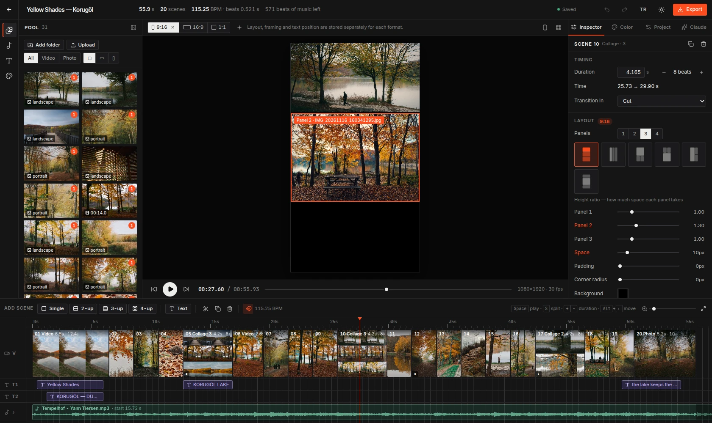
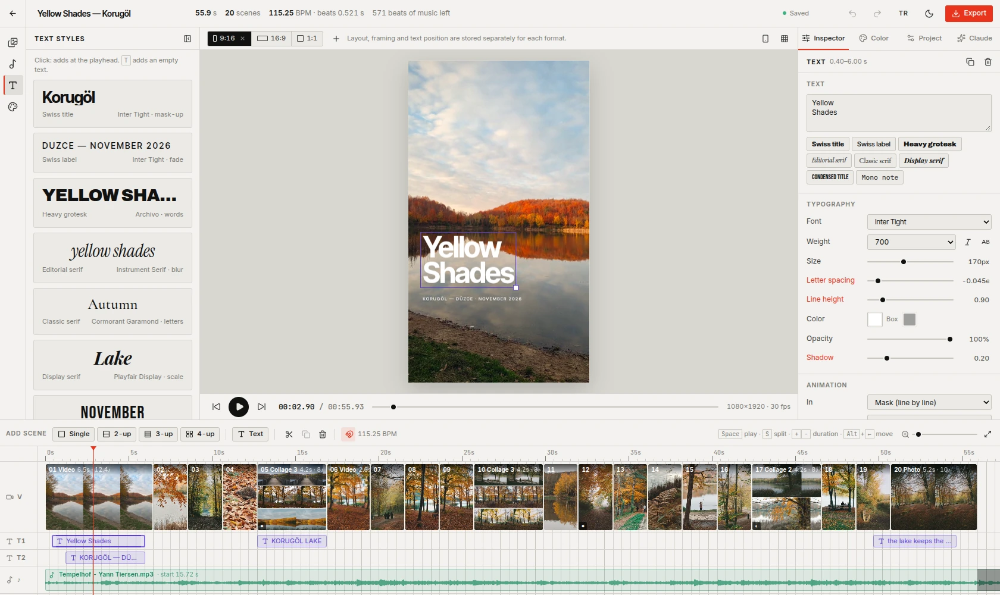
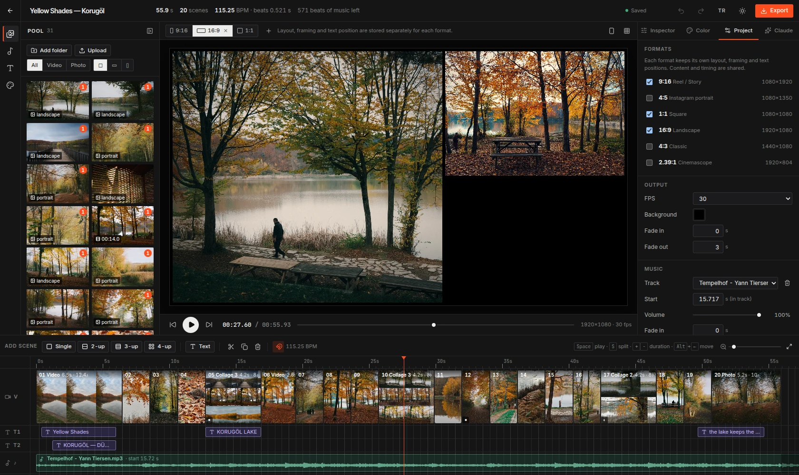
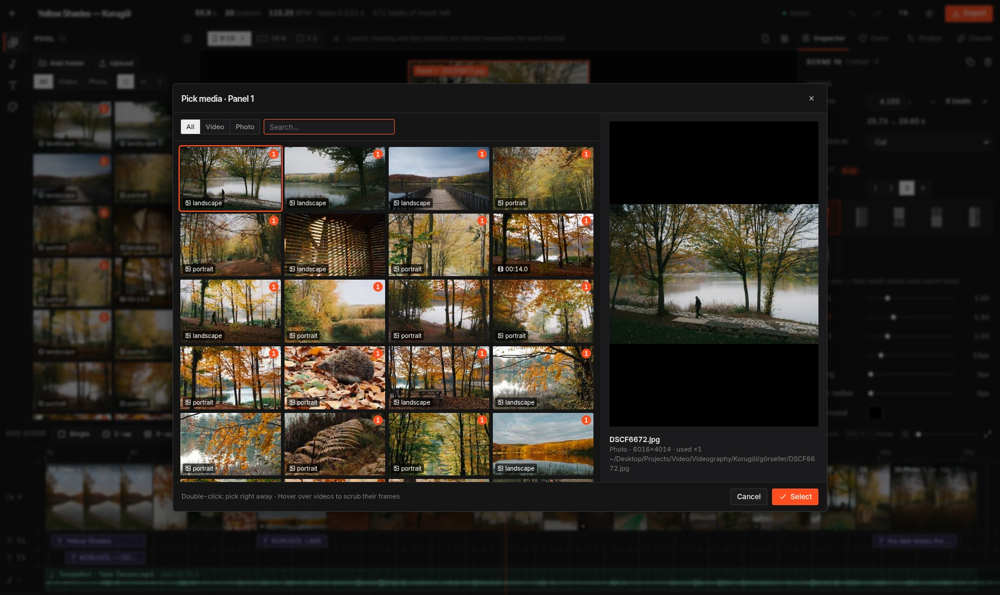
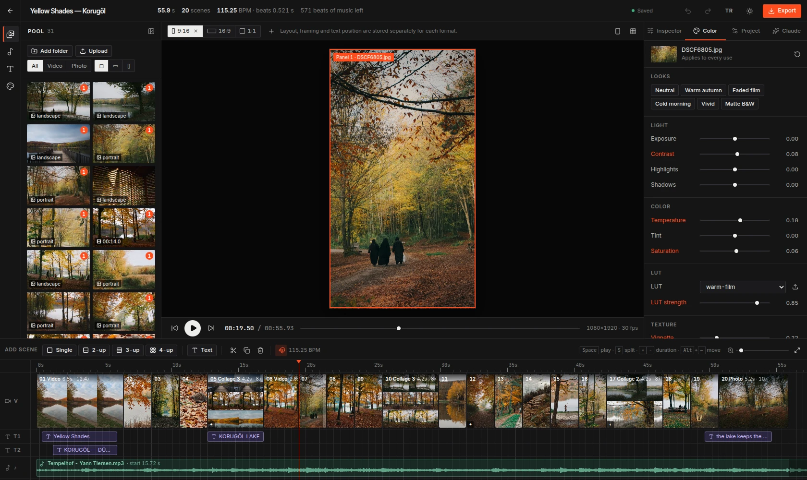
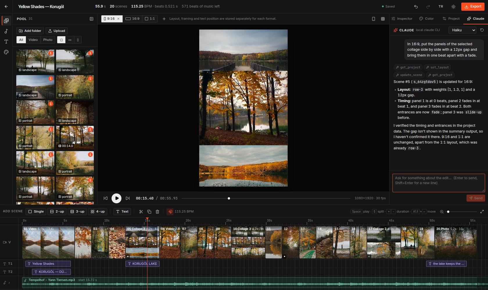
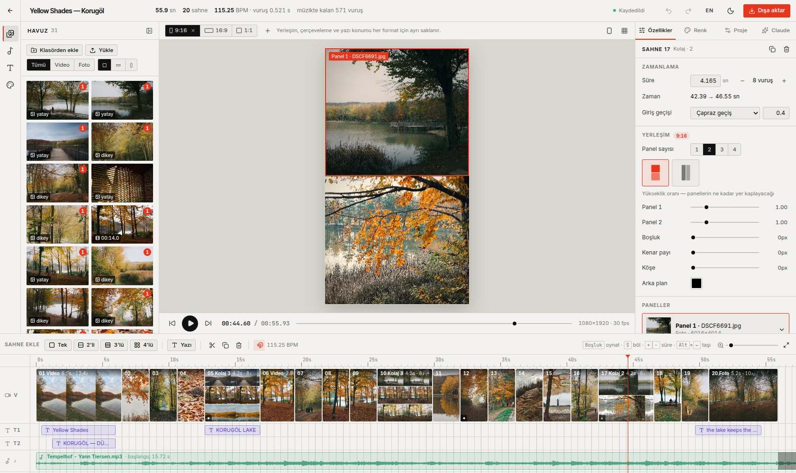

# Edittor

> [!WARNING]
> **Under construction.** Edittor is an early work in progress. Features, the project file format and the MCP tools may change without notice, and you should expect bugs. Keep backups of projects you care about.

A minimal, reusable editor for reels and short videos. Build an edit from a pool of photos and videos, lay them out as collages, cut to the beat of your music, grade them with 3D LUTs, add animated type, and export several aspect ratios from the same project. You can also let Claude build the edit for you.

Each project is a plain folder with a single `project.json`, so it can be versioned, diffed, generated by scripts, or edited by an AI agent.

The interface is available in **English and Turkish** (toggle in the top bar).



## Features

- **Modern NLE layout:** media pool on the left, preview in the middle, a tabbed inspector on the right (Inspector · Color · Project · Claude), and a multi-track timeline at the bottom (scenes, text tracks, music waveform with a beat grid).
- **Scenes and collages:** single shots or 2-, 3- and 4-panel collages with 14 layout presets. Drag a slider to set how much space each panel takes. Mix video and photos in the same collage. Bring panels in one by one, on the beat, with an entrance animation.
- **Pick media visually:** choose a panel's media from a preview picker and hover over videos to scrub their frames. Drag thumbnails onto the timeline or straight onto a panel in the preview.
- **Framing and slip:** set fill or fit per panel. Drag a panel in the preview to reframe it and use the wheel to zoom. When a video is longer than its slot, drag a window over its filmstrip to choose which part is shown.
- **Multiple aspect ratios in one project:** 9:16, 4:5, 1:1, 16:9, 4:3 and 2.39:1. **Layout, framing and text position are stored per format.** Content and timing are shared.
- **Music and tempo:** automatic BPM detection, tap tempo, snapping to beats, beat-based durations (`+` / `−` adds or removes a beat), and fade in / out.
- **Color:** exposure, contrast, highlights, shadows, temperature, tint, saturation, vignette, grain and **3D LUTs (`.cube`)**, with built-in looks. A grade belongs to the pool item and applies everywhere it is used.
- **Animated text:** 20 Google Fonts (Swiss grotesks, serifs, monos) plus your system fonts, 8 style presets, 11 in-animations (mask reveal, letter by letter, word by word, typewriter, blur, tracking…) and 7 out-animations.
- **Photos in motion:** Ken Burns zoom and pan, speed control for videos, and scene transitions (cross-dissolve, dip to black or white, slide, zoom).
- **WYSIWYG export:** the export runs the same WebGL compositor as the preview, frame by frame, from the original files, then encodes H.264 with WebCodecs. Several formats can be exported in one go.
- **Reels helpers:** an Instagram Reels safe-zone overlay and a rule-of-thirds grid.
- **Claude built in:** a chat panel that drives your locally installed `claude` CLI, plus an MCP server and a skill, so Claude Code can build or refine edits from outside the app. Changes appear live in the editor and can be undone.
- **Light and dark themes**, undo / redo, autosave, keyboard shortcuts.

| | |
|---|---|
|  |  |
| **Text styles** in the light theme | **Per-format layouts:** the same collage in 16:9 |
|  |  |
| **Media picker** with a preview | **Color grading** with a 3D LUT |
|  |  |
| **Claude** editing the project through MCP | **Turkish interface** |

## Requirements

- [Bun](https://bun.sh) 1.3 or later
- `ffmpeg` and `ffprobe` on your `PATH` (for proxies, thumbnails, waveforms and audio muxing). NVENC is used automatically when available, with `libx264` as the fallback.
- A Chromium-based browser (Chrome, Chromium, Brave, Edge) for WebGL2 and WebCodecs
- Optional: [Claude Code](https://claude.com/claude-code) for the chat panel and the MCP server

## Getting started

```bash
git clone <your-fork-url> edittor
cd edittor
bun install
bun run dev        # API server on :5174, UI on http://localhost:5173
```

Or run the built version on a single port:

```bash
bun run build
bun run start      # http://127.0.0.1:5174
```

Projects are stored in `~/EdittorProjects/` by default. Set `EDITTOR_PROJECTS=/some/path` to change it, and `PORT` to change the API port.

## Project format

```
~/EdittorProjects/<project-id>/
├── project.json   # the whole edit: pool, scenes, collages, texts, grades, music, formats
├── media/         # files uploaded through the browser (folders you add stay where they are)
├── luts/          # imported .cube files
├── exports/       # rendered MP4s
└── .cache/        # thumbnails, filmstrips and 720p proxies (safe to delete)
```

Files added with **Add folder** are referenced by their absolute path and are not copied.

A trimmed `project.json`:

```json
{
  "formats": ["9:16", "16:9"],
  "tempo": { "bpm": 115.25, "offset": 0.22, "snap": true },
  "music": { "path": "/music/track.mp3", "offset": 15.7, "fadeOut": 3 },
  "pool": [{ "id": "a_1", "kind": "image", "path": "/photos/DSCF6672.jpg",
             "grade": { "temperature": 0.18, "lut": "l_warm", "lutMix": 0.85 } }],
  "scenes": [{
    "duration": 4.165,
    "cells": [
      { "assetId": "a_1", "fit": "cover", "enterDelay": 0 },
      { "assetId": "a_2", "fit": "cover", "in": 9, "enterDelay": 0.52, "enter": "fade" },
      { "assetId": "a_3", "fit": "cover", "enterDelay": 1.04, "enter": "fade" }
    ],
    "layouts": {
      "9:16": { "preset": "stack-3", "weights": [1, 1.8, 1], "gap": 10 },
      "16:9": { "preset": "row-3", "weights": [1, 1.3, 1], "gap": 12 }
    }
  }],
  "texts": [{ "text": "Yellow\nShades", "font": "Inter Tight", "animIn": "mask-up",
              "layouts": { "9:16": { "x": 0.5, "y": 0.62, "size": 170, "align": "left" } } }]
}
```

The full schema lives in [`shared/types.ts`](shared/types.ts).

## Using it with Claude

**Inside the editor:** open the **Claude** tab on the right. It runs the `claude` CLI installed on your machine with your existing login, so no API key is needed. The selected scene, active format and playhead are added to the context automatically, and Claude replies in the interface language.

**From Claude Code:** this repository ships with `.mcp.json` and a skill in `.claude/skills/edittor`, so running `claude` inside the repo is enough. To use it from anywhere else:

```bash
claude mcp add edittor -- bun /path/to/edittor/mcp/index.ts
```

Then ask something like *"Add ~/Videos/korugol to a new project and build a 45-second reel on the beats of the music"*. With the editor open, you will watch the edit appear, and every step can be undone with Ctrl+Z.

The MCP server exposes tools such as `get_project`, `look_at_assets` (thumbnails and filmstrips, so Claude can see the footage), `import_media`, `set_music` (with tempo detection), `replace_edit`, `add_scenes`, `set_layout`, `add_text` and `set_grade`. Editing guidelines for instrumental reels are in [`skill/edittor/SKILL.md`](skill/edittor/SKILL.md).

## Architecture

| Layer | Technology |
|---|---|
| UI | React 19 + Vite, zustand (undo, autosave, live sync over WebSocket) |
| Preview | WebGL2 compositor ([`web/src/engine/gl.ts`](web/src/engine/gl.ts)): fill / fit, framing, rounded corners, grading, 3D LUT, vignette, grain. Text is drawn with Canvas2D. |
| Export | The same compositor, frame by frame, on the original files. Video is encoded to H.264 with WebCodecs ([mediabunny](https://mediabunny.dev)), audio is mixed with an `OfflineAudioContext`, and the server muxes it to AAC with ffmpeg. |
| Server | Bun: file access, ffprobe, sharp, NVENC / x264 proxies, waveforms, BPM detection |
| Claude | MCP server over stdio ([`mcp/index.ts`](mcp/index.ts)), a skill, and the in-app chat (local `claude` CLI) |

Every frame is computed by one pure function, `evaluateFrame` in [`web/src/engine/frame.ts`](web/src/engine/frame.ts). Because the preview and the export both use it, the export matches the preview.

## Keyboard shortcuts

| Key | Action |
|---|---|
| `Space` | Play / pause |
| `←` / `→` | Previous / next frame (`Shift`: 1 second) |
| `↑` / `↓` | Previous / next scene |
| `Alt` + `←` / `→` | Move the selected scene |
| `S` | Split at the playhead |
| `T` | Add text |
| `+` / `−` | Lengthen / shorten the scene by one beat |
| `Ctrl` + `D` | Duplicate |
| `Del` | Delete |
| `Ctrl` + `Z` / `Ctrl` + `Shift` + `Z` | Undo / redo |
| `Ctrl` + `E` | Export |

In the preview, dragging a selected panel reframes it, the wheel zooms, and a double-click opens the media picker.

## Notes

- Linux builds of Chromium have no AAC encoder, so the browser encodes video only and the server muxes audio with ffmpeg. If the browser lacks an H.264 encoder, it falls back to VP9 and the server transcodes to H.264.
- A desktop app can be made by wrapping the same code in Electron. Tauri is not recommended on Linux: its WebKitGTK webview has no WebCodecs.

## Roadmap

Edittor is under active development. Planned work, roughly in order:

### 1. Richer animation and transitions
- [ ] More scene transitions: whip pan, push, zoom blur, light leak, film burn, glitch, luma / gradient wipes, shape masks
- [ ] Custom easing curves and per-transition duration presets tied to the beat grid
- [ ] Keyframes for panel framing, scale, rotation and opacity
- [ ] Panel exit animations, plus staggered collage entrances driven by the music

### 2. Text animation and styles
- [ ] More text animations: per-line slide, scramble / decode, counter, highlight sweep, underline draw, split reveal, kinetic word stacks
- [ ] Text style presets with outline, gradient fill, highlight boxes, drop and long shadows
- [ ] Multiple styles inside one text layer (mixed weights, colors and fonts)
- [ ] Savable custom style and animation presets
- [ ] Captions: import SRT / VTT and auto-time words to the beat

### 3. Animation engines and vector graphics
- [ ] [GSAP](https://gsap.com) timelines for text and overlay animation
- [ ] [Anime.js](https://animejs.com) support
- [ ] SVG animation layers (animated shapes, line drawing, logos, stickers, Lottie-style graphics)
- [ ] A deterministic, frame-accurate bridge so these animations render the same in preview and export

### 4. Overlays and blend modes
- [ ] Overlay layers for text, images and video on top of scenes
- [ ] Blend modes: multiply, screen, overlay, soft light, add, difference, color, luminosity…
- [ ] Overlay assets such as light leaks, film grain, dust and textures, with per-layer opacity and masking
- [ ] Track mattes: text as a mask for video

### 5. Sound effects library
- [ ] A built-in library of transition and UI sounds: clicks, whooshes, swishes, risers, hits, camera shutters, film-projector ticks
- [ ] Auto-place sounds on transitions, collage panel entrances and text animations, aligned to the beat grid
- [ ] An SFX track on the timeline with volume, fades and ducking under the music
- [ ] Import your own sound packs, and optionally browse free libraries (e.g. Freesound) from the app
- [ ] MCP tools so Claude can add sound effects as part of an edit

### 6. Native Linux version
- [ ] A native desktop app in a faster language (likely Rust with wgpu, or another native stack), reading and writing the same `project.json` format
- [ ] GPU decoding and encoding (VA-API / NVDEC / NVENC) for smooth 4K preview and faster export
- [ ] Shared render rules between the web and native versions, so both produce the same output

## License

[GPL-3.0](LICENSE)
